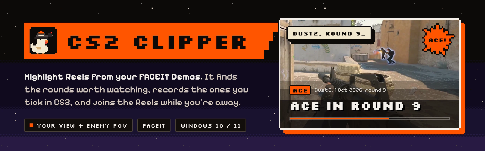
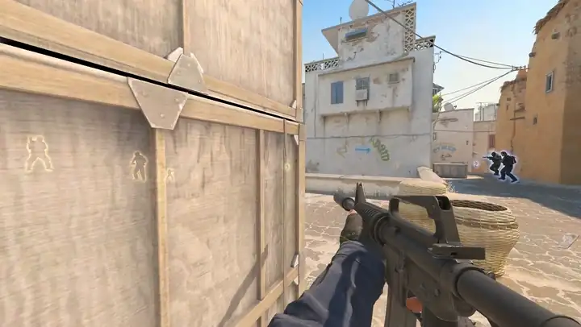
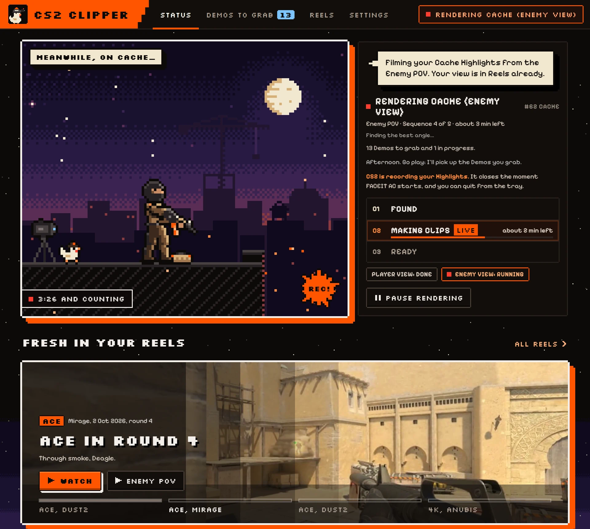
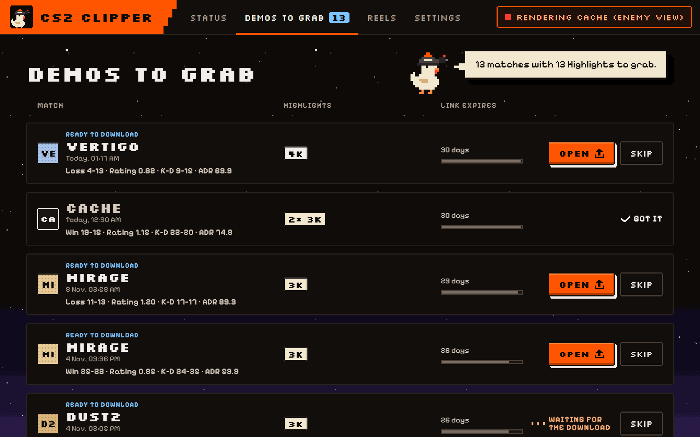
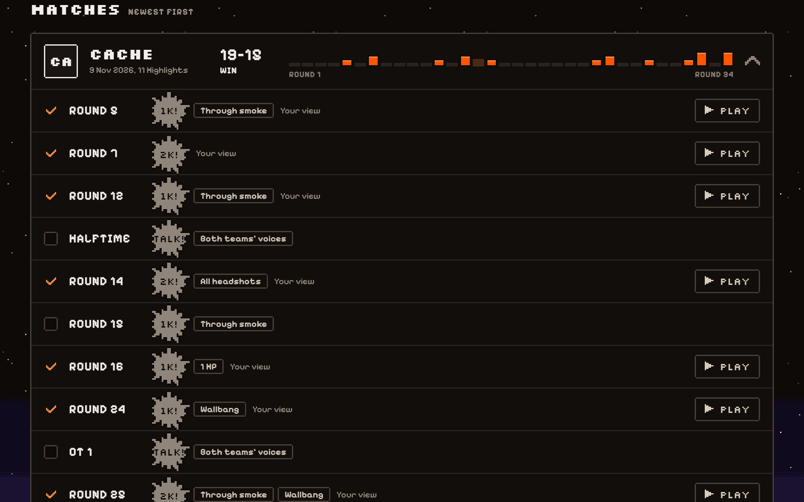
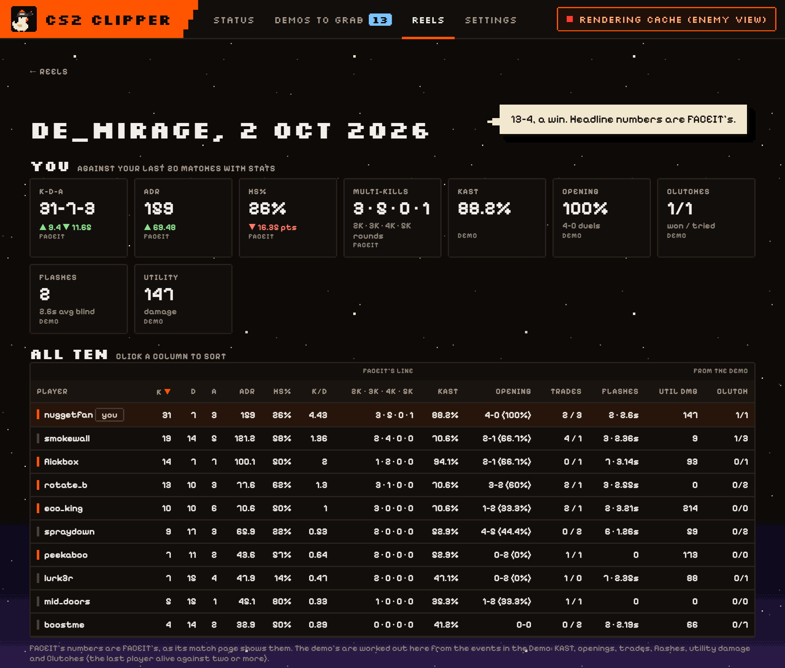
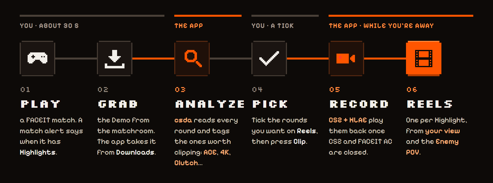

<p align="center">
  
</p>

<p align="center">
  <a href="https://github.com/MohammadAM02/cs2-clipper/releases/latest"></a>
  
  
  
  <a href="LICENSE"></a>
</p>

<h3 align="center">Play FACEIT. Download the Demo. Come back to your Highlights.</h3>

<p align="center">
  CS2 Clipper finds the rounds worth watching in your FACEIT Demos, records the ones you pick in CS2<br>
  from your view <i>and</i> the enemy's, and joins them into Reels. No editor, no timeline, just a tick per round.
</p>

<p align="center">
  <a href="https://github.com/MohammadAM02/cs2-clipper/releases/latest/download/CS2Clipper-Setup.exe"><b>Download for Windows</b></a>
  &nbsp;·&nbsp; <a href="#how-it-works">How it works</a>
  &nbsp;·&nbsp; <a href="#install">Install</a>
  &nbsp;·&nbsp; <a href="#build-from-source">Build from source</a>
</p>

<p align="center">
  
  <br>
  <sub>Round 9 on Dust2, the start of an Ace. The app found it, recorded it and joined the Reel on its own.</sub>
</p>

## What's new in 0.13.0

### The map's weather behind every page

- **Pixel weather instead of the night round.** The window behind every page now shows the weather of the map
  Status last showed: snow for Office, blowing sand for Dust2 and Mirage, rising embers for Inferno and Nuke, rain
  for Anubis and Overpass, and fireflies for Ancient. Any other map gets a clear night, with stars drifting by and a
  few that twinkle. Like the rest of the app it moves in pixel steps, and the next page you open picks it up where
  it was.
- **The round still plays on Status's monitor** and in the first-run banner, and the Highlights carousel still shows
  its setting until a Reel's frame is ready.
- **It rests like the scene did.** The weather stops while the window isn't in front, and holds still when Calm mode
  is on or Windows asks for less motion (Settings › Accessibility › Visual effects › Animation effects).

Every version before it is in the [changelog](CHANGELOG.md), and the app shows a version's notes when it offers
the update.

## What it does

- **Finds your rounds, and you pick.** Every round with 2 or more of your Frags is worth clipping, and so is a
  single Frag with something to it: a Desert Eagle or knife, a no-scope, a jump shot, a wallbang, through smoke,
  while flashed, on 20 HP or less, or one that wins a Clutch. Each match lists them on the Reels page with their
  tags (and the halftime talk); tick the ones you want, press **Clip**, and only those get recorded. Add more
  rounds later the same way.
- **Records them in the game.** CS2 plays the Demo back through HLAE, and each Frag is recorded at 60 fps
  with its build-up: 4 seconds before, 2 after.
- **Shows both sides.** Every Highlight comes twice: from your view, and from an Enemy POV that follows
  each player you take down. Keep just one in Settings → Picture → Views to render, and each match records
  half as much, so it renders faster.
- **Zero FPS cost.** It does nothing while CS2 is open, not even reading a Demo, and records only once CS2 and
  FACEIT AC are closed: after a 30-second heads-up (with **Not now**), and it stops the moment FACEIT AC starts.
  Status and the tray show how much memory and CPU the app itself takes.
- **Tells you what to grab.** Match alerts flag the FACEIT matches that have Highlights, and Demos to grab
  counts down to the day FACEIT's link expires. That page opens on your phone too.
- **Plays them back, and shares them.** The Reels page holds every Highlight, filtered by Aces, 4Ks, 3Ks or
  all-headshot rounds. Click one to watch it; from the player, **Copy file** (paste it straight into Discord),
  **Export for Discord** (under the 20 MB free limit), **9:16** for TikTok, Shorts and Reels, or **Show in folder**.
  Exports open on a title card with your name, the map and the round. Reels open on your phone too.
- **Shows every match's numbers.** Each match on the Reels page has **Stats**: K/D/A, ADR, HS%, KAST, opening
  kills, trades, flashes, utility damage, Clutches and 2K–5K rounds for all ten players, FACEIT's own numbers first,
  with arrows against your last 20 matches. The round timeline links each kill to its Reel, and **Replay this
  round** draws the round on the map's radar.

## A look inside

<p align="center">
  
  <br>
  <sub><b>Status</b>: what the app is doing right now, the latest Highlights, and whether this PC is ready.</sub>
</p>

<table>
  <tr>
    <td width="50%"></td>
    <td width="50%"></td>
  </tr>
  <tr>
    <td align="center"><sub><b>Demos to grab</b>: matches worth downloading, and how long each link lasts.</sub></td>
    <td align="center"><sub><b>Reels</b>: tick the rounds to clip, then watch each Highlight from either view and share it.</sub></td>
  </tr>
</table>

<p align="center">
  
  <br>
  <sub><b>Stats</b>: every match's numbers for all ten players, FACEIT's first, and each round's kills linked to their Reels.</sub>
</p>

## How it works

<p align="center">
  
</p>

Each Demo moves through the same steps; Status sums them up as Found, Making clips (with about how long is left)
and Ready. Every step can run again, so a crash or a reboot picks up where it stopped, and none runs while CS2 is
open.

| Step | What happens |
| --- | --- |
| **Spotted** | A finished FACEIT Demo lands in Downloads and moves into your clips folder. |
| **Unpacked** | The `.dem.zst` FACEIT serves becomes a `.dem`. |
| **Analyzed** | [csda](https://github.com/akiver/cs-demo-analyzer) reads every round; the app keeps what it needs as `analyses\<checksum>.json`, with the match's stats beside it. |
| **Scored** | Each round with your Frags becomes a Highlight. The ones worth clipping wait on the Reels page for you to pick, and a toast says the match is ready; **Clip** sends the Demo on with your picks. |
| **Rendering** | HLAE starts CS2 and a console script ([`hlae_plan.py`](clipper/hlae_plan.py)) records each Sequence at its exact ticks, one view per CS2 launch: your view first, whose Reels are joined and announced straight away, then the Enemy POV (or only the view Settings picks). CS2 and its encoder run below normal priority. |
| **Joined** | FFmpeg joins each Highlight's Clips into one Reel per view. |
| **Done** | The unpacked `.dem` is deleted, and a toast says the Reels are ready, with **Watch** and **Show in folder**. |

### Safe around FACEIT AC

Nothing starts CS2 unless the **Gate** is clear: no CS2 running, FACEIT AC off (neither its service nor its
client), Steam running, at least 5 GB free on the clips drive, and the time Settings → **Start renders** allows
(any time, once the PC has been idle 10 minutes, or overnight). When FACEIT AC or a closed Steam is all that holds
it up, a toast says so. While it records, the app keeps checking; if FACEIT AC
starts, it closes the game it launched straight away and redoes that render later. CS2 only ever starts for
offline Demo playback, and the app never touches a CS2 you started yourself.

## Install

1. **Download** [`CS2Clipper-Setup.exe`](https://github.com/MohammadAM02/cs2-clipper/releases/latest/download/CS2Clipper-Setup.exe)
   from the [latest release](https://github.com/MohammadAM02/cs2-clipper/releases/latest) and run it. It
   installs for your Windows account only, with no admin prompt, and starts in the tray when you sign in
   (untick that in the installer if you'd rather it didn't).
2. **Set up in one go.** The app opens on one screen: look up your FACEIT nickname (that fills in your
   SteamID), keep or change the clips folder (`Videos\CS2 Clipper`), and the tools it records with, csda, FFmpeg
   and HLAE (about 122 MB), download by themselves into `%LOCALAPPDATA%\CS2Clipper\tools`.

> **Needs** Windows 10 or 11, CS2 installed through Steam (with Steam running while it records), a FACEIT
> account and 5 GB free on the clips drive.

From 0.3.0 on, the app updates itself: when a new version is out, Status shows what changed and installs it
with one click, keeping your settings, Demos and Reels. What changed in each version is in the
[changelog](CHANGELOG.md).

## Using it

1. **Play a FACEIT match.** When it has Highlights, a match alert says so, and the match shows up in
   Demos to grab.
2. **Download the Demo** with **Open**, which takes you to the matchroom. The app can't fetch it for you:
   FACEIT keeps Demo downloads behind a partner-only API ([ADR 0001](docs/adr/0001-faceit-only-ingestion.md)).
3. **Pick your rounds.** Once the Demo is analyzed, a toast says the match is ready to pick, and **Pick rounds**
   opens it on the Reels page. Tick the rounds you want (and the halftime talk) and press **Clip**.
4. **Walk away.** Status shows each step, and the tray icon says what the app is doing.
5. **Watch** with the toast's **Watch**, on the Reels page, or open the files: a folder per match in
   `<clips folder>\library\videos`, like `2026-10-12 Dust2 13-9\ACE Dust2 R9 you.mp4`. Exports go to
   `<clips folder>\Exports`.
6. **Look back** with **Stats** under any match on the Reels page, and **Replay this round** to see a round on
   the radar.

> [!TIP]
> A CS2 update can break HLAE until advancedfx ships a fix. Status checks for new HLAE releases every day
> and says when one is out.

## Build from source

You need [uv](https://docs.astral.sh/uv/); it fetches Python 3.13 itself.

```powershell
git clone https://github.com/MohammadAM02/cs2-clipper
cd cs2-clipper
uv sync
uv run clipper     # the app: tray, window and pages
uv run pytest      # over 1,600 tests; none needs CS2, HLAE or FACEIT
```

Run from source, the app needs your own FACEIT Data API key in Settings → You; installed builds ship one.
Set `CLIPPER_DATA_DIR` to keep a development copy's data apart from the installed app's.

| Command | What it does |
| --- | --- |
| `clipper` | the app (`--open reels` opens a page; `--background` starts in the tray) |
| `clipper setup` | installs what this PC lacks: csda, FFmpeg and HLAE |
| `clipper status` | every Demo's state, and the Gate |
| `clipper retry <demo>` | sends a failed Demo back through |
| `clipper resume` | resumes rendering after a pause |
| `clipper highlights <demo>` | prints the scored Highlights of an analyzed Demo |
| `clipper quit` | asks the running copy to quit, and waits until it has |

`packaging\build.ps1 -Installer` builds `dist\CS2Clipper\` (PyInstaller: `CS2Clipper.exe` and the `_internal\`
folder it runs from) and `dist\CS2Clipper-Setup.exe` (Inno Setup). Pushing a `v*` tag runs the
[release workflow](.github/workflows/release.yml): the tests, the build, a proof on a clean runner (install, upgrade,
an update from the latest release, uninstall), then a GitHub Release with the installer, whose notes are the
version's section of [CHANGELOG.md](CHANGELOG.md).

## Project layout

```text
clipper/              the app
├── pages/            Status, Demos to grab, Reels, Stats, Replay and Settings: plain HTML, CSS and JS
│   └── fonts/        Silkscreen and Pixelify Sans, the 16-bit lettering
├── worker.py         moves each Demo through the steps
├── intake.py         takes finished Demos from Downloads
├── analysis.py       the only code that reads csda's output
├── scoring.py        a round's facts become a Highlight and its Score
├── gate.py           may CS2 launch right now?
├── hlae_plan.py      Sequences become the console script CS2 follows
├── hlae_render.py    one Render Job: CS2 through HLAE, watched to the end
├── join.py           Clips become one Reel per view
├── stats.py          what each player did in a Demo, worked out from its events
├── replay.py         a round's positions, once a second, for Replay
├── radar.py          each map's radar, read from the installed CS2
├── alerts.py         match alerts from the FACEIT Data API
├── update.py         finds a newer release on GitHub and installs it with one click
├── app.py            tray, window, web server and worker, together
└── …
tests/                pytest; a whole Render Job runs against a scripted world
packaging/            the PyInstaller spec, the Inno Setup script, build and proof scripts
scripts/              faceit_probe.py, a one-shot check of what a FACEIT key can read
docs/
├── adr/              architecture decisions
├── agents/           how coding agents work in this repo
├── images/           the pictures in this README
└── index.html        GitHub Pages: hands a FACEIT sign-in back to the app
.scratch/             design specs and open issues
CONTEXT.md            the words this project uses: Demo, Highlight, Frag, Reel, Enemy POV…
CHANGELOG.md          what changed in each release; a version's section becomes its release notes
```

## Credits

CS2 Clipper is built on open-source work:

- [HLAE](https://github.com/advancedfx/advancedfx) by advancedfx (MIT) drives CS2 and records it.
- [cs-demo-analyzer](https://github.com/akiver/cs-demo-analyzer) by akiver (MIT) reads every Demo.
- [CS Demo Manager](https://github.com/akiver/cs-demo-manager) by akiver (MIT): its Sequence builders and the
  commands its video export sends are ported in [`hlae_plan.py`](clipper/hlae_plan.py).
- [Aegis](https://github.com/thelifeofsuleyman/cs2-clipper) by thelifeofsuleyman (MIT): the app shell, tray,
  window and installer started from it.
- [faceitperf](https://github.com/iffypixy/faceitperf) by iffypixy (MIT): the Rating 2.0 estimate.
- [FFmpeg](https://ffmpeg.org), in [gyan.dev's builds](https://www.gyan.dev/ffmpeg/builds/), joins the Clips.
- [Silkscreen](https://github.com/googlefonts/silkscreen) and [Pixelify Sans](https://github.com/eifetx/Pixelify-Sans)
  (SIL Open Font License) letter every page.

## License

[MIT](LICENSE). The code adapted from Aegis, CS Demo Manager and faceitperf keeps its authors' MIT notices in
the files it lives in, and the fonts keep their Open Font License beside them in `clipper/pages/fonts`.

<sub>Not affiliated with Valve or FACEIT. Counter-Strike 2 is a trademark of Valve Corporation.</sub>
